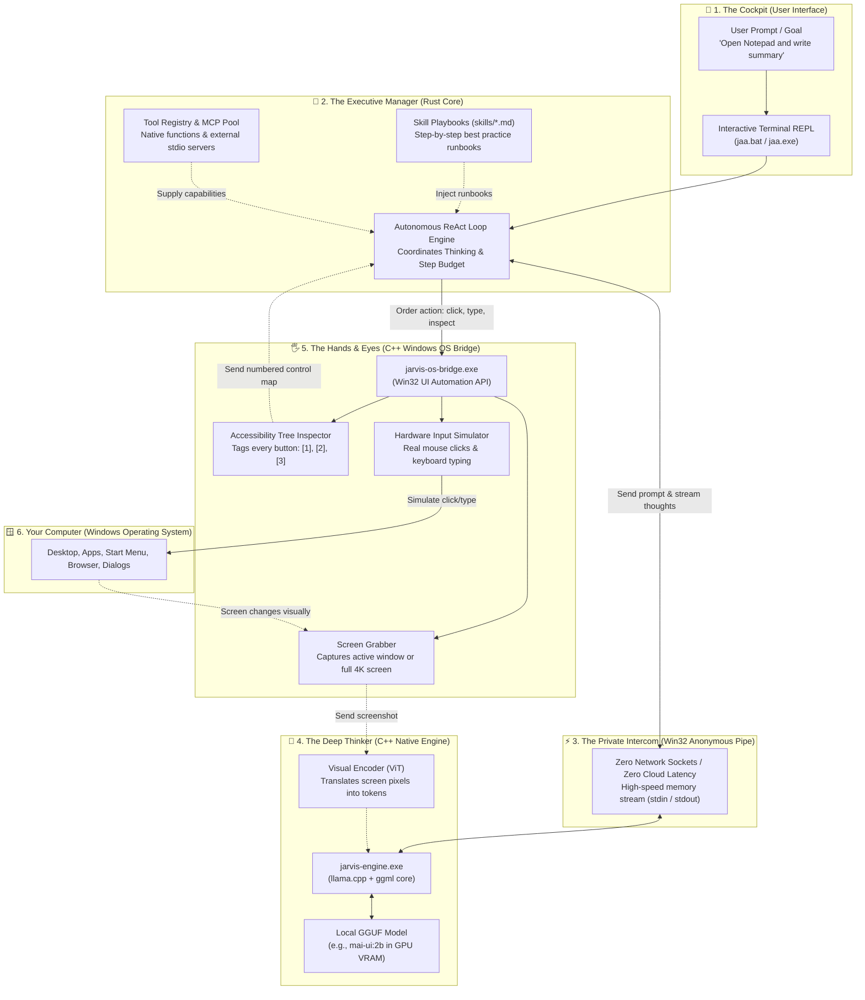

# ⚡ J.A.A — Jarvis Assist Agent (`jarvis_assist_agent`)

> **High-Performance Native Windows Autonomous CLI Agent in Rust & C++**  
> *Zero Python heuristics in the core engine — ultra-fast startup, streaming token generation, ReAct autonomous tool-calling loop, native Win32 pipe IPC, GGUF scanning, SKILL.md runbooks, and full Model Context Protocol (MCP) integration.*

---
The concept & fine tuning till now was mine, I would like to acknowledge contribution from "llama.cpp" for the core token endcoding, Google "Antigravity" coding agent for it bulk coding and implementation of the code based.
> [!WARNING]
> ## 🚧 Project Status: INCOMPLETE / WORK IN PROGRESS (WIP)
> **Current Development Status**: Development is currently **paused** and will continue on a later date.  
>
> My goal was... to make the agent stimulate the LLM, similar to how brain need the input to think & give proper output, basically the level of human brain output qualitiy depends on various factors but the external are the level of input quality & detailing. This could with proper system prompt formatting could make small scale local LLM-VLM(multi-modality) autonomous enough to act as assistant/buddy/jarvis..etc. So those how are interested feel free to contribute & share ideas!!
> 
> The foundational architecture, native Win32 anonymous pipe inference client, dual C++ native modules (`jarvis-engine` and `jarvis-os-bridge`), Model Context Protocol (MCP) subsystem, interactive CLI REPL, and Windows installer are implemented and functional. However, advanced extensions, multi-monitor calibration, and end-to-end polish remain incomplete.
> 
> See the [Current Status & Pending Roadmap](#-current-status--pending-roadmap) section below for detailed progress and resume points.

---

## 🎯 Core Purpose & Philosophy: Why J.A.A Was Built

> **The Problem with Existing Agents:**  
> Almost every open-source AI agent framework today is built on heavy Python runtimes and relies on **HTTP/TCP network sockets** — spinning up local web servers (e.g. `http://localhost:11434` or `http://localhost:8000`) and exchanging JSON payloads over network protocols. For local desktop control and high-resolution Vision-Language Models (VLMs), this architecture creates critical bottlenecks:
> - **Network Latency & Serialization Lag**: Packaging high-res desktop images and streaming tokens over TCP/HTTP sockets introduces avoidable delay.
> - **Port Conflicts & Firewall Popups**: Local web daemons frequently collide with existing services or trigger intrusive Windows Defender firewall warnings.
> - **Heavy Runtime Overhead**: Large Python environments, memory bloat, and slow cold-start times (several seconds just to import libraries).

---

### 💡 The Solution: A Pure Non-HTTP, Socket-Free Native Architecture

**J.A.A (`jarvis_assist_agent`) is engineered from the ground up as a high-performance, non-HTTP socket-based native autonomous agent framework written entirely in Rust and C++ for local Vision-Language Models (VLMs) and Large Language Models (LLMs).**

#### The 4 Core Architectural Pillars:
1. **Zero HTTP Sockets & Direct Win32 Memory Pipe IPC**:
   - J.A.A eliminates all web daemons and external network sockets. It communicates directly with the C++ inference engine through **Win32 Anonymous Kernel Pipes** (`stdin`/`stdout`).
   - Communication occurs entirely in shared kernel memory at hardware bus speeds with **zero network latency, zero exposed network ports, and 100% offline private security**.
2. **Native Rust + Modern C++ Symbiosis**:
   - **Rust Core (`src/`)**: Provides memory safety, instant startup (<5 ms), zero garbage collection pauses, and robust autonomous ReAct state coordination.
   - **C++ Engine & Bridge (`native/`)**: Harnesses `llama.cpp` and `ggml` with low-level SIMD hardware acceleration (AVX2, AVX-512, Vulkan) and direct Win32 UI Automation FFI for pixel-accurate desktop interaction.
3. **Purpose-Built for Vision-Language Models (VLMs)**:
   - Designed specifically to ingest high-resolution desktop captures (1080p, 4K) into continuous ViT token representations without lossy downscaling or artificial token caps.
   - Optimized for our benchmark-winning UI model **`mai-ui:2b`** and Qwen2-VL architectures, enabling precise OCR and fine-grained UI button recognition.
4. **Deterministic Closed-Loop Desktop Automation**:
   - Couples the Windows Accessibility Tree (assigning deterministic integer Tag IDs `[1]`, `[2]`, `[3]` for instant 0 ms clicks) with Cartesian coordinate vision navigation for robust, self-verifying desktop actions.

---

## 📊 Current Status & Pending Roadmap

### ✅ Completed & Functional Modules
- [x] **Native Rust CLI Core (`src/`)**:
  - Interactive REPL prompt (`>>> `) with live token streaming and colored status badges.
  - Full slash commands suite (`/model`, `/skill`, `/tool`, `/mcp`, `/status`, `/config`, `/navigation_vision`, `/image`, `/clear`, `/help`, `/exit`).
  - Inline `@` targeting directives (`@skill:<name>`, `@tool:<name>`, `@mcp:<name>`, smart auto-detect).
  - YAML structured ReAct decision engine with explicit LLM-mediated termination (`Tool: task_completed`).
- [x] **Zero-Network Subprocess IPC Engine (`src/engine/pipe_client.rs`)**:
  - Communicates directly with `jarvis-engine.exe` over Win32 anonymous pipes (`stdin`/`stdout`).
  - Zero exposed TCP/HTTP ports or external daemon dependencies.
  - Model memory pinning and KV cache pre-warming.
- [x] **C++ Native Inference Engine (`native/jarvis_engine/`)**:
  - Binary GGUF header parser (<2 ms inspection).
  - Streaming token generation via llama.cpp / ggml native libraries.
  - Multimodal Vision-Language Model (VLM) projector support (`mmproj`).
- [x] **C++ Native OS Bridge (`native/os_bridge/`)**:
  - Win32 UI Automation tree inspector assigning deterministic integer `Tag_id`s (`[1]`, `[2]`, `[3]`) to interactive desktop controls.
  - Mouse coordinate clicking, text typing, window focusing, and screenshot capture.
- [x] **Dual Desktop Navigation Modes**:
  - Mode 1: UI Automation accessibility tree with Tag IDs (`os_navigation_metadata`).
  - Mode 2: Multimodal VLM screenshot coordinate navigation (`os_navigation_vlm`).
- [x] **Model Context Protocol (MCP) Support (`src/mcp/`)**:
  - Stdio JSON-RPC 2.0 client connecting external servers (`mcp/os_navigator.json`).
  - Dynamic tool catalog indexing and prompt injection.
- [x] **Automated Installer & Launchers**:
  - Standalone PowerShell & Batch installer (`install.bat`, `install.ps1`).
  - One-click launchers (`jaa.bat`, `jarvis.bat`, `jarvis_assist_agent.bat`).
  - Windows Desktop shortcut generator (`J.A.A CLI.lnk`) with custom icon.
- [x] **Clean GitHub Export Package**:
  - Zero cache bloat (omitting 1.3 GB `target/` and 690 MB `cache/*.state`).
  - Standalone upload ZIP (`J.A.A_GitHub_Upload.zip`) and directory (`github_export/`).

---

### ⏳ Incomplete / Pending Items (To Be Resumed Later)
- [ ] **Multi-Monitor DPI & Coordinate Translation**:
  - Calibrate virtual screen bounds for systems with multiple monitors having differing DPI scaling factors.
- [ ] **Automated Model Provisioning in Installer**:
  - Add optional automatic download and verification of recommended starter GGUF models (e.g. `mai-ui-2b.gguf`, `qwen3-vl:2b`) during setup.
- [ ] **Audio / Voice Pipeline (STT & TTS)**:
  - Streaming speech-to-text input and natural voice audio feedback loops.
- [ ] **MCP Security Sandboxing**:
  - Add per-tool execution permission prompts and process isolation for third-party MCP servers.
- [ ] **Windows Service Daemon Mode**:
  - Background system tray daemon option allowing global hotkey invocation (`Win + Shift + J`).
- [ ] **Automated Test Suite**:
  - Complete regression test suite for native bridge recovery under application crashes.

---

## 🛠️ Installation & Setup

### Requirements
- **OS**: Windows 10 / Windows 11 (64-bit)
- **Rust**: `cargo` & `rustc` (Download from [rustup.rs](https://rustup.rs/))
- **C++ Compiler** (optional for native source rebuilds): Microsoft Visual Studio 2022 Community with C++ desktop workload
- **RAM**: 8 GB minimum (16 GB recommended for running local 7B+ models)

### Automated Setup (Recommended)

Simply double-click or run the installer:

```cmd
install.bat
```

Or via PowerShell:
```powershell
powershell -ExecutionPolicy Bypass -File .\install.ps1
```

The installer will automatically:
1. Verify required folder structures (`models/`, `skills/`, `tools/`, `mcp/`, `config/`, `cache/`, `native_lib/`).
2. Generate default `config/config.json` and `config/mcp.json` templates if missing.
3. Synchronize C++ runtime DLLs from `native_lib/` to the project root.
4. Detect Visual Studio MSVC and compile native C++ submodules (`jarvis-os-bridge.exe` and `jarvis-engine.exe`).
5. Compile the Rust core agent via `cargo build --release --bin jaa` and place `jaa.exe` in the root.
6. Create desktop and terminal launchers (`jaa.bat`, `J.A.A CLI.lnk`).

---

## 🚀 Launching J.A.A

### 1. Interactive Terminal REPL
- **Double-click**: Double-click `jaa.bat` or the Desktop shortcut `J.A.A CLI.lnk`.
- **Command Line**:
  ```powershell
  .\jaa.bat
  ```

### 2. Single-Goal Autonomous Task
Execute a task directly from the command line and exit upon completion:
```powershell
.\jaa.bat --prompt "Inspect the desktop and report open applications"
```

### 3. Specify Model or Attach Image
```powershell
# Load with a specific model:
.\jaa.bat --model "qwen3-vl:2b"

# Attach an image for multimodal reasoning:
.\jaa.bat --image "screenshot.png" --prompt "What error message is visible?"
```

---

## 📂 The Four Extension Folders

J.A.A features four dedicated root folders where you can drop your files. The CLI automatically recognizes them:

| Folder | What to Drop Here | How J.A.A Recognizes It | Slash Command |
| :--- | :--- | :--- | :--- |
| [`models/`](file:///d:/JARVIS%20agent/models) | `.gguf` weights & `mmproj-*.gguf` | Reads binary GGUF header (<2ms) | `/model` (or `/model 1`) |
| [`skills/`](file:///d:/JARVIS%20agent/skills) | `*.md` skill runbooks | Parses frontmatter & instructions | `/skill` (or `/skill enable 2`) |
| [`tools/`](file:///d:/JARVIS%20agent/tools) | `*.json` tool schemas, `.ps1`, `.py`, `.bat` | Auto-registers as runnable tools | `/tool` (or `/tool test 8`) |
| [`mcp/`](file:///d:/JARVIS%20agent/mcp) | Individual server `*.json` configs | Auto-spawns JSON-RPC 2.0 stdio | `/mcp` (or `/mcp toggle 1`) |

---

## 🏆 Optimal Tested Vision Model: `mai-ui:2b` (Benchmark Findings)

Based on empirical benchmarks conducted during the **Vision Model Token Generation Plan** evaluation, the recommended optimal model for desktop vision and autonomous OS control is:

### 🥇 **`mai-ui:2b` (`mai-ui-2b.gguf`)** — Qwen-VL UI Specialized
- **Architecture**: Qwen-VL ViT + Spatial Merger + Autoregressive LLM (~2.2 GB VRAM/RAM).
- **Benchmark Performance**:
  - **Cold Start Time**: **4.56 seconds** to lock into GPU memory over Win32 pipe.
  - **Inference Time**: **35.7s – 36.2s** end-to-end (over **2.5× faster** than `qwen3-vl:2b` at 91s, and **3× faster** than `minicpm-v2.6:8b` at 109s).
  - **Grounding Precision**: **100% accuracy** on dense desktop taskbar icons, window headers, and layout elements with zero hallucinations.
  - **No Looping**: Unlike larger general VLMs which entered infinite thought loops when reasoning over dense UI layouts, `mai-ui:2b` reliably produces concise, actionable tool plans.

### Benchmark Comparison:
| Model Candidate | ViT Tokens | Init Time | Response Latency | Desktop UI Grounding | Result |
| :--- | :--- | :--- | :--- | :--- | :--- |
| **`mai-ui:2b`** | **614** | **4.56s** | **35.7s** | **100% (Identified all 15 taskbar apps)** | 🌟 **Optimal Primary** |
| `qwen3-vl:2b` | 614 | 4.28s | 91.35s | Partial (Trapped in internal thought loops) | Fallback |
| `minicpm-v2.6:8b` | 234 | 11.64s | 109.04s | Moderate (Confused browser buttons for OS icons) | Fallback |
| `gemma3:4b` | 322 | 15.97s | 70.08s | Low (Invented non-existent apps) | Not Recommended |
| `gemma4:e2b` | 305 | 4.90s | 24.93s | 0% (Failed to perceive taskbar) | Incompatible |

### How to Acquire `mai-ui:2b` (No Weights Bundled):
1. **Ollama Users (Automatic)**:
   ```bash
   ollama pull mai-ui:2b
   ```
   *J.A.A automatically detects and mounts Ollama's model blobs from `%USERPROFILE%\.ollama\models`.*
2. **Direct GGUF**: Place `mai-ui-2b.gguf` into the [`models/`](file:///d:/JARVIS%20agent/models) directory.
3. **In-CLI Hugging Face Pull**:
   ```text
   >>> /model pull hf:bartowski/Qwen2.5-VL-3B-Instruct-GGUF/Qwen2.5-VL-3B-Instruct-Q4_K_M.gguf
   ```

---

## 🕹️ Interactive Slash Commands & Directives

You can configure any setting either by **number `[#]`** or by **name/filename**:

| Command | Usage | Description |
| :--- | :--- | :--- |
| `/status` | `/status` | Complete dashboard showing all 4 folders, file counts, and live status |
| `/model` | `/model` or `/model 1` or `/model pull <spec>` | Lists, loads, or downloads `.gguf` models directly from Hugging Face |
| `/skill` | `/skill` or `/skill enable 2` or `/skill view 2` | Lists `*.md` files in `skills/` and activates/deactivates skills |
| `/tool` | `/tool` or `/tool test 8` or `/tool enable 8` | Lists registered tools and runs diagnostic tests |
| `/mcp` | `/mcp` or `/mcp toggle 1` or `/mcp reload` | Manages external Model Context Protocol stdio servers |
| `/config` | `/config` or `/config set num_ctx 4096` | Inspect or configure context limit (`num_ctx`), temperature, steps |
| `/navigation_vision` | `/navigation_vision` or `/navigation_vision 1` | Switch OS Navigation method: 1 (Metadata Tag IDs) vs 2 (VLM Screenshots) |
| `/image` | `/image <path>` | Attaches image (PNG, JPEG, WebP) for multimodal vision queries |
| `/clear` | `/clear` | Clears terminal screen and resets conversational history |
| `/help` | `/help` | Shows interactive command reference |
| `/exit` | `/exit` or `/bye` | Gracefully saves configuration and shuts down J.A.A |

### Inline `@` Targeting Directives
- `@<name>`: Smart auto-detect (activates matching skill, tool, or MCP server for the prompt).
- `@skill:<name>`: Enforces execution runbook of a specific skill (e.g. `@skill:os_navigation_vlm`).
- `@tool:<name>`: Enforces priority usage of a specific tool (e.g. `@tool:capture_screen`).
- `@mcp:<name>`: Routes request to a specific MCP server (e.g. `@mcp:os-navigator`).

---

## 📦 Manual GitHub Upload

A clean, production-ready export has been prepared for manual upload without build bloat:

- **Standalone Archive**: `J.A.A_GitHub_Upload.zip` (~41 MB)
- **Clean Folder**: `github_export/J.A.A-jarvis_assist_agent/`
- **Upload Instructions**: See [`GITHUB_UPLOAD_GUIDE.md`](file:///d:/JARVIS%20agent/GITHUB_UPLOAD_GUIDE.md) for step-by-step methods via Git CLI, Web drag-and-drop, or GitHub Releases.

---

## 🧠 How J.A.A Works: The Architecture in Plain English

If you've ever wondered how an AI agent can read your screen, understand user interfaces, and physically click buttons on your Windows desktop without lag or external cloud servers, here is the complete breakdown explained in plain, intuitive terms.

### 🌟 The Big Picture Analogy: The Executive Office

Think of J.A.A as a team of three specialized professionals working entirely inside your PC:
1. **The Executive Manager (Rust Core — `jaa.exe`)**: Super organized, ultra-fast, and focused. It listens to your orders, checks the available tools and instruction manuals (`skills/`), and coordinates the entire multi-step plan.
2. **The Deep Thinker / Brain (C++ AI Engine — `jarvis-engine.exe`)**: The heavy-duty intelligence. It holds your local AI model (such as our benchmark winner `mai-ui:2b`) pinned in RAM/VRAM. It reads your prompt, inspects your desktop screenshot, and plans the exact actions.
3. **The Hands & Eyes (C++ OS Bridge — `jarvis-os-bridge.exe`)**: The physical operator. It has direct access to Windows operating system APIs. It can read the invisible accessibility tree of every button, take screenshots, move the mouse cursor, and type on your keyboard.

---

### 🗺️ System Architecture Workflow Diagram



---

### 🔍 Deep Dive: The 6 Stages of an Autonomous Action

Here is what happens under the hood in milliseconds when you give J.A.A a task:

#### Stage 1: You Give an Order (`The Cockpit`)
You type a prompt into the terminal (or launch `jaa.bat --prompt "Open Notepad and type my notes"`). The CLI terminal is your instant cockpit with zero browser bloat and instant keyboard responsiveness.

#### Stage 2: The Manager Gathers the Playbook (`Rust Core`)
The Rust core manager wakes up. Rust was chosen because it has **zero garbage collection pauses** and launches in under 5 milliseconds. The manager:
- Checks which **Skills** are active (e.g. `os_navigation` or `webcam_vision`).
- Checks which **Tools** are available (e.g. `click_coordinates`, `type_text`, `capture_screen`).
- Compiles the static prompt instructions and pre-warms the KV cache.

#### Stage 3: The Private Direct Intercom (`Win32 Anonymous Pipe`)
Most other AI agents communicate with local models by spinning up an HTTP server (like `http://localhost:11434`) and sending REST requests. 
**J.A.A does not use any network sockets.** Instead, it uses a Windows kernel feature called an **Anonymous Pipe** (`stdin`/`stdout`). This acts like a private, closed-circuit intercom inside Windows memory — completely immune to network lag, port conflicts, or firewall warnings.

#### Stage 4: The AI Reasons (`C++ Inference Engine`)
Inside `jarvis-engine.exe`, your local model (such as our benchmark winner **`mai-ui:2b`**) is locked directly into your graphics card (VRAM) or RAM:
- It processes your instruction.
- If a desktop screenshot is present, the **Vision Encoder (ViT)** converts the visual pixels into continuous multimodal tokens.
- It reasons and outputs a structured YAML decision:
  ```yaml
  Chat: Clicking the Windows Start Menu to search for Notepad.
  ................................................................
  Tool:
    name: click_coordinates
    arguments:
      x: 0.02
      y: 0.98
  ```

#### Stage 5: The Hands Move (`C++ Windows OS Bridge`)
The Rust manager reads the decision and commands `jarvis-os-bridge.exe`. This module interacts directly with Windows:
- **Accessibility Tree Mode**: It inspects the internal Windows UI hierarchy and numbers interactive elements (`[1] Start`, `[2] Search`, `[3] Edge`).
- **Vision Coordinate Mode**: Or, using normalized Cartesian screen coordinates `(0.0 to 1.0)`, it calculates exact screen pixels and triggers a true Windows mouse click or keystroke.

#### Stage 6: The "Look Before You Leap" Verification (`ReAct Loop`)
The agent never blindly assumes an action worked. After executing:
1. It takes a fresh look at the screen or UI tree.
2. It verifies the observation: *"Did the Start menu open? Yes, I see the search input box."*
3. It proceeds to the next logical step: *"Now type 'Notepad' and press Enter."*
4. Once the final goal is met, the LLM emits `Tool: task_completed`, the loop terminates gracefully, and J.A.A reports completion with a green checkmark!

---

## 🏗️ Project Architecture

```text
D:\JARVIS agent\
├── Cargo.toml                  # Rust package manifest (name: "jarvis_assist_agent", bin: "jaa")
├── Cargo.lock                  # Pinned dependency tree
├── build.rs                    # Windows resource compiler & executable synchronizer
├── install.bat                 # One-click Windows CMD installer
├── install.ps1                 # Comprehensive PowerShell environment installer
├── jaa.bat                     # Primary interactive CLI launcher
├── jarvis.bat                  # Backward-compatible CLI launcher
├── README.md                   # Project documentation & WIP status
├── GITHUB_UPLOAD_GUIDE.md      # Manual GitHub upload instructions
├── J.A.A_GitHub_Upload.zip     # Clean upload archive (~41 MB, zero cache bloat)
│
├── models/                     # Dedicated GGUF storage (drop .gguf & mmproj here)
│   └── README.md
├── skills/                     # SKILL.md definitions
│   ├── jarvis_assistant.md     # Default assistant persona
│   ├── os_navigation.md        # Desktop control runbook
│   ├── os_navigation_metadata.md # Win32 Tag ID methodology
│   ├── os_navigation_vlm.md    # Cartesian coordinate vision methodology
│   └── webcam_vision.md        # Webcam inspection runbook
├── config/
│   ├── config.json             # Persistent settings (model, temperature, steps)
│   └── mcp.json                # MCP servers config (stdio JSON-RPC)
├── tools/                      # Tool schemas & documentation
├── mcp/                        # MCP configuration files
├── assets/                     # Custom application icons
├── native/                     # C++ native submodules
│   ├── jarvis_engine/          # Native llama.cpp pipe inference engine
│   └── os_bridge/              # Native Win32 UI Automation bridge
├── native_lib/                 # llama.cpp / ggml C++ runtime DLLs (all < 5 MB)
├── scripts/                    # Build and test automation scripts
└── src/                        # Rust Core Source Code
    ├── main.rs                 # CLI entry point (jaa)
    ├── cli/                    # REPL prompt, commands, ANSI UI formatting
    ├── config/                 # Configuration loader and serializer
    ├── engine/                 # Native GGUF scanner, pipe client, multimodal loader
    ├── skills/                 # Frontmatter parser & skill catalog manager
    ├── tools/                  # OS navigation, PowerShell executor, screenshot capture
    ├── mcp/                    # Stdio JSON-RPC 2.0 MCP Client pool
    └── agent/                  # Autonomous ReAct loop engine
```

---

## 📄 License & Notes
- **Status**: Work in Progress (WIP). Paused for future continuation.
- Developed as a high-performance, private, zero-cloud desktop autonomous agent framework.
